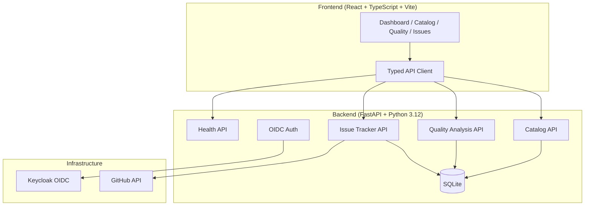

# Vector Observatory — Alan Vo

> Work in progress. This checkpoint may be incomplete or fail tests. See PLAN.md and STATUS.md before use.


**Vector Observatory** — Alan Vo | AI & Machine Learning

An AI/ML plugin observatory for knowledge workers using Claude Cowork. This application catalogs plugins and skills from the [knowledge-work-plugins](https://github.com/anthropics/knowledge-work-plugins) repository, providing searchable discovery, automated quality analysis, and GitHub issue triage workflows.

## Problem

Knowledge workers using Claude Cowork need a reliable way to discover, evaluate, and manage plugins and skills from the growing ecosystem. The upstream `knowledge-work-plugins` repository contains hundreds of skills across domains (bio-research, marketing, sales, legal, productivity), but lacks:

- **Searchable catalog** — No central index to find skills by domain, stability, or capability
- **Quality signals** — No stability lifecycle (experimental/stable/deprecated) to distinguish production-ready skills from early prototypes
- **Issue visibility** — GitHub issues are scattered; no triage dashboard to track broken integrations (e.g., Google Calendar MCP shutdown, MS365 auth errors)
- **Content quality** — No automated detection of AI-generated content patterns, especially for non-English languages like Chinese

## Solution

Vector Observatory implements three core workflows:

1. **Plugin/Skill Catalog** — Browse, search, and filter skills with metadata (domain, stability, tags, source). Import from reference repository with automated extraction.
2. **GitHub Issue Triage** — Ingest and display issues from the upstream repo with filtering by plugin, label, and status. AI-assisted triage suggestions (opt-in, advisory).
3. **Content Quality Analysis** — Deterministic offline engine for detecting Chinese AI-generated content patterns (filler phrases, punctuation abuse, structural clichés). No LLM required for core analysis.

## Architecture



## Features

| Feature | Status | Description |
|---------|--------|-------------|
| Health Check API | ✅ Implemented | `/api/v1/health` and `/api/v1/health/db` endpoints |
| Plugin Catalog API | 🚧 Planned | CRUD, search, pagination, filtering |
| Skill Detail View | 🚧 Planned | Full skill metadata with stability badge |
| GitHub Issue Ingestion | 🚧 Planned | Sync issues from upstream repo |
| Chinese Quality Analysis | 🚧 Planned | 30+ banned phrases, punctuation rules, 4-layer scoring |
| OIDC Authentication | 🚧 Planned | Keycloak with viewer/analyst/admin roles |
| Docker Compose | ✅ Implemented | Backend, frontend, Keycloak with health checks |

## Quick Start

### Prerequisites

- Docker and Docker Compose
- Node 24+ (for local frontend development)
- Python 3.12+ (for local backend development)

### Using Docker Compose (Recommended)

```bash
# Clone and enter repository
git clone https://github.com/ALANDVO/vector-observatory-alan-vo.git
cd vector-observatory-alan-vo

# Copy environment template
cp .env.example .env

# Start all services
docker compose up -d

# Services available at:
# - Frontend: http://localhost
# - Backend API: http://localhost:8000
# - Keycloak Admin: http://localhost:8080 (admin/admin)
```

### Local Development

**Backend:**
```bash
cd backend
python3 -m venv .venv
source .venv/bin/activate
pip install -r requirements.txt
uvicorn app.main:app --reload --host 127.0.0.1 --port 8000
```

**Frontend:**
```bash
cd frontend
npm install
npm run dev
```

## API Reference

### Health Endpoints

| Method | Endpoint | Description |
|--------|----------|-------------|
| GET | `/api/v1/health` | Basic service health |
| GET | `/api/v1/health/db` | Database connectivity |

Response format:
```json
{
  "status": "healthy",
  "service": "Vector Observatory",
  "version": "1.0.0"
}
```

### Planned Endpoints

| Method | Endpoint | Description |
|--------|----------|-------------|
| GET | `/api/v1/plugins` | List plugins (paginated, filterable) |
| GET | `/api/v1/plugins/{id}` | Get plugin with skills |
| GET | `/api/v1/skills` | List skills (paginated, filterable) |
| GET | `/api/v1/skills/{id}` | Get skill detail |
| POST | `/api/v1/quality/analyze` | Analyze Chinese content quality |
| GET | `/api/v1/issues` | List GitHub issues |
| GET | `/api/v1/issues/{number}` | Get issue detail |

## AI/ML Evaluation

### Chinese Content Quality Analysis (Planned)

**Approach:** Deterministic offline rules engine based on [stop-slop-zh](https://github.com/pencil20388-eng/stop-slop-zh) patterns:
- 30+ banned Chinese AI filler phrases (e.g., "总而言之", "值得一提的是", "不得不说")
- Punctuation rules: AI overuses colons (：), em-dashes (——), double quotes ("")
- 50+ recommended colloquial expressions for natural voice
- 4-layer quality check: hard rules → style → content → human-feel

**Reproducible Command:**
```bash
curl -X POST http://localhost:8000/api/v1/quality/analyze \
  -H "Content-Type: application/json" \
  -d '{"text": "您的中文文本内容"}'
```

**Data Provenance:** Patterns derived from empirical analysis of Chinese LLM outputs across multiple models (GPT-4, Claude, Qwen, DeepSeek). Not a benchmark — heuristic rules with known false positives/negatives.

**Limitations:**
- Heuristic rules, not a calibrated classifier
- False positives on formal/academic Chinese
- Does not detect English AI patterns (separate module needed)
- No semantic understanding — purely syntactic/lexical

## Security Limitations

- **Development defaults:** Keycloak uses `admin/admin` and `dev-secret-change-in-production` — MUST change in production
- **SQLite:** Single-file database; not suitable for high-concurrency production
- **No TLS:** Docker Compose binds to 127.0.0.1 only; production requires reverse proxy with TLS
- **LLM keys:** Optional; stored server-side only; never exposed to frontend
- **No secret rotation:** Manual `.env` management; integrate with vault in production

## Provider Configuration

| Provider | LLM_PROVIDER | LLM_MODEL | LLM_BASE_URL |
|----------|--------------|-----------|--------------|
| OpenAI | `openai-compatible` | `gpt-4o-mini` | (default) |
| Anthropic | `anthropic` | `claude-3-5-sonnet-latest` | (default) |
| Google Gemini | `gemini` | `gemini-1.5-flash` | (default) |
| Ollama | `ollama` | `llama3.1` | `http://host.docker.internal:11434/v1` |
| LiteLLM/OpenRouter | `openai-compatible` | (model) | (gateway URL) |

## SSO/SAML Setup

Keycloak supports SAML identity providers via Identity Brokering:

1. In Keycloak Admin Console → Identity Providers → Add SAML v2.0
2. Configure IdP metadata (entity ID, SSO URL, certificates)
3. Map SAML attributes to Keycloak user attributes (email, name, groups)
4. Enable "Store Token" and "Trust Email" for seamless linking
5. Test with SP-initiated and IdP-initiated flows

See [Keycloak SAML Broker docs](https://www.keycloak.org/docs/latest/server_admin/#_saml_v2_0_identity_providers) for details.

## Backup & Restore

**Database (SQLite):**
```bash
# Backup
docker compose exec backend cp /app/data/vector_observatory.db /app/data/backup-$(date +%F).db

# Restore
docker compose exec backend cp /app/data/backup-2026-10-20.db /app/data/vector_observatory.db
```

**Keycloak:**
```bash
# Export realm
docker compose exec keycloak /opt/keycloak/bin/kc.sh export --dir /opt/keycloak/data/export --realm vector-observatory

# Import (on new instance)
docker compose -f compose.yaml up -d keycloak
# Realm auto-imports from /opt/keycloak/data/import/realm-export.json
```

## Development

### Running Tests

```bash
# Backend tests
cd backend
source .venv/bin/activate
PYTHONPATH=. pytest tests -v

# Frontend tests
cd frontend
npm test
```

### Type Checking

```bash
# Backend
cd backend
source .venv/bin/activate
mypy app

# Frontend
cd frontend
npm run build  # includes tsc
```

### Linting

```bash
# Frontend
cd frontend
npm run lint
```

## Project Structure

```
vector-observatory-alan-vo/
├── backend/
│   ├── app/
│   │   ├── api/           # API routes
│   │   ├── core/          # Configuration
│   │   ├── db/            # Database session
│   │   ├── models/        # SQLAlchemy models
│   │   ├── services/      # Business logic
│   │   └── main.py        # FastAPI app factory
│   ├── tests/             # Pytest tests
│   ├── requirements.txt
│   └── Dockerfile
├── frontend/
│   ├── src/
│   │   ├── components/    # React components
│   │   ├── __tests__/     # Vitest tests
│   │   ├── App.tsx
│   │   └── main.tsx
│   ├── package.json
│   ├── tsconfig.json
│   ├── vite.config.ts
│   ├── nginx.conf
│   └── Dockerfile
├── keycloak/
│   └── realm-export.json
├── compose.yaml
├── .env.example
├── .gitignore
├── pyproject.toml
├── README.md
├── LICENSE
├── CHANGELOG.md
└── portfolio.json
```

## License

MIT License — Copyright (c) 2026 Alan Vo <alanvo@gmail.com>

See [LICENSE](LICENSE) for full text.

---

*Vector Observatory — Alan Vo | AI & Machine Learning*